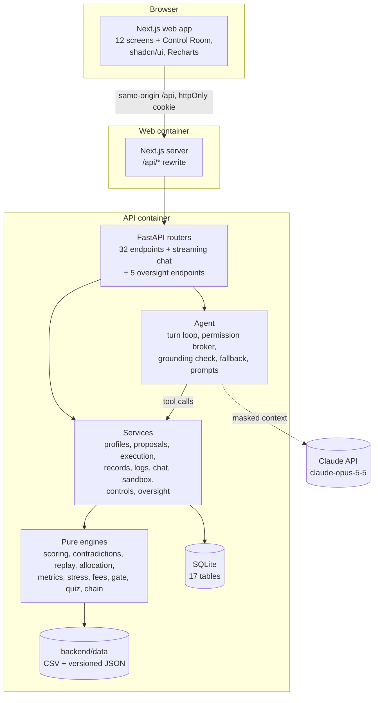
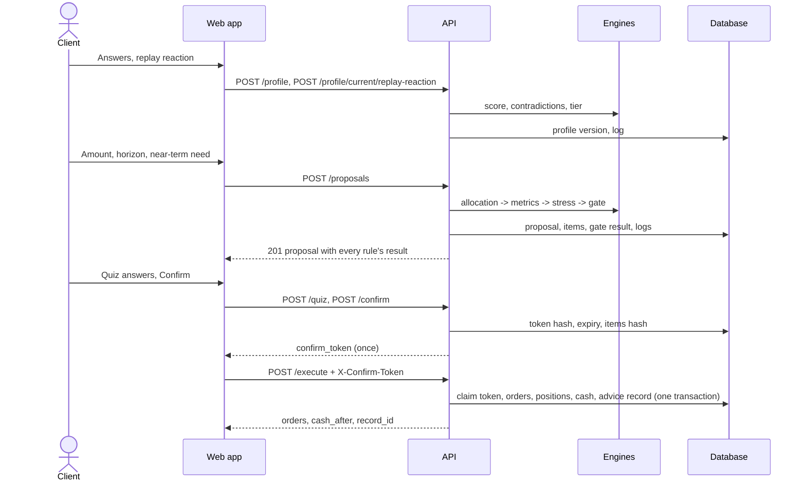

# Aegis Wealth AI — Technical Documentation

Deliverable 01: system architecture, core algorithms and security design, as built. The requirements,
API contract and screen specifications are in the project documentation (Chapters 1 to 3); this
document describes the implementation and the decisions taken while building it.

## 1. System architecture

Aegis is a web application with two services and one database.

| Layer | Technology | Responsibility |
| --- | --- | --- |
| Web app | Next.js 16 (App Router), React 19, TypeScript, Tailwind CSS 4, shadcn/ui, TanStack Query, Recharts | Screens S01 to S12 plus the AI Control Room, the shared design system, the chat drawer with cards, client-side validation |
| API | Python 3.12, FastAPI, Pydantic 2 | The contract (Section 2.6): validation, roles, error envelope, OpenAPI |
| Services | SQLAlchemy 2 | Transactions, ownership, the operation log, orchestration of engines |
| Engines | Plain Python | Every number and every rule, as pure functions of versioned data files |
| Agent | Anthropic Python SDK | A manual tool-use loop behind a permission broker |
| Database | SQLite (WAL) | The 16 tables of Section 3.5, plus `controls` for the compliance switches; append-only triggers on records and the log |

**One origin.** The browser only talks to the web server; Next.js forwards `/api/*` to FastAPI
(`API_BASE_URL`), so there is no CORS, and the session cookie stays httpOnly and same-site.

**Contract-first.** The Pydantic schemas are the contract. FastAPI publishes them as OpenAPI
(`backend/openapi.json`), and the frontend's types are generated from that file
(`frontend/src/lib/api-types.ts`, NFR-5.2), so a backend change that breaks a screen fails the
frontend type check.

**Mock-first frontend.** With `NEXT_PUBLIC_API_MOCK=1`, the same screens run on an in-browser mock API
(MSW) whose engines are ports of the backend's. `scripts/verify.ts` checks the ports against the same
worked examples.

## 2. Request flow: one advisory run

## 3. Core algorithms

All engines live in `backend/app/engines/` and take every input as an argument: no file, database or
network access (NFR-5.1). Money and percentages round **half away from zero** (`numbers.py`), which the
worked examples in Section 2.6.5 require (Python's `round()` would give S2 as −6.72% instead of
−6.73%).

### 3.1 Risk profiling (`scoring.py`, `contradictions.py`, `replay.py`)

- Capacity (C1 to C5) and willingness (W1 to W5) each score points ÷ 20 × 100, a multiple of 5. Bands:
  0–20 → 1, 25–40 → 2, 45–60 → 3, 65–80 → 4, 85–100 → 5.
- Tier T = min(T_cap, max(1, T_will − a_replay)). Only a "sell everything" reaction in the historical
  replay sets a_replay = 1, and only once.
- Contradictions X1 to X3 save the profile as `needs_review`. Proposals then return
  409 CONTRADICTIONS_OPEN until an answer changes.
- Replay: V_t = V_{t−1}(1 + Σ_c w_c r_{c,t}) from CNY 100,000, using the tier's model portfolio over
  episode E1 (2007-11 to 2009-10), E2 (2020) or E3 (2022). It reports the series, maximum drawdown,
  lowest month and end value.
- **Replay as a time machine** (addition). The client may start from their own amount
  (`GET /api/replay/{id}?amount=`, CNY 10,000 to 10,000,000); the path scales with it, so the
  drawdown is the same. The screen plays the episode month by month next to the real events of those
  months (Lehman Brothers, the WHO pandemic declaration, the first Fed rate rise, ...; the events are
  real, the portfolio path is illustrative). It stops by itself at the lowest month and asks *"Your
  CNY 200,000 is now CNY 138,722. What do you do?"*, so the reaction is recorded at the worst moment,
  not after the recovery. After the answer it plays on and shows what selling at the bottom would
  have kept against holding to the end. With reduced motion, Play jumps to the end.

Worked example (AT-03): answers C1 b, C2 d, C3 c, C4 b, C5 d, W1 c, W2 c, W3 d, W4 c, W5 b give capacity
70, willingness 70, tier 4. "Sell everything" lowers it to 3.

### 3.2 Allocation (`allocation.py`)

The seven steps of Section 2.5.3, in order:

1. **Base weights** from the tier's model portfolio.
2. **Horizon cap.** Under 3 years, equity + gold ≤ 20%. The excess comes from equity first, then gold,
   and goes to bond (tier 1: cash).
3. **Liquidity floor.** Cash ≥ ⌈N / A × 100⌉%, with the shortfall taken pro rata. Computed with exact
   fractions: in floating point, 7,000 / 100,000 × 100 is 7.000000000000001, which a plain ceiling
   turns into 8.
4. **Rounding** to whole percents, half up. A positive remainder goes to cash. A negative remainder
   comes out of the largest non-cash class, so rounding can never break the floor or the cap; the
   horizon cap is re-checked after rounding. (Putting a negative remainder into cash, as the
   documentation literally says, gave 6% cash against a 7% floor for tier 5.)
5. **Product choice.** Keep products with risk ≤ T, lock-up ≤ H × 12 and minimum investment ≤ the
   slot; sort by fee, then liquidity days, then code. Cash with N > 0 is liquid products only.
6. **Split.** A non-cash class above 40% is split between its two cheapest products; the first takes
   the odd 1%.
7. **Empty class.** If no product qualifies, the class's weight moves into the cash item, and a note
   explains why.

Every item carries a **reason**, e.g. *"Bond is 50% of this mix, above the 40% limit for one product,
so it is split between the two lowest-fee bond products that suit tier 3. This one charges 0.30% a
year."* After a revision, the reason records the change.

Worked example (AT-06, Section 2.6.5): tier 3, CNY 200,000, 8 years, CNY 30,000 near-term need gives:

| Product | Weight | Amount (CNY) |
| --- | --- | --- |
| DEP-01 | 15% | 30,000 |
| SBF-01 | 25% | 50,000 |
| SBF-02 | 25% | 50,000 |
| GLD-01 | 10% | 20,000 |
| IDX-01 | 25% | 50,000 |

An exhaustive sweep (every tier, horizons 1–30, five amounts, needs 0–100%: 75,750 allocations)
found no case that breaks a total of 100%, the floor, the cap, suitability or the 40% limit.

### 3.3 Metrics, stress tests, fees (`metrics.py`, `stress.py`, `fees.py`)

- r_{p,t} = Σ w_c r_{c,t}; σ_annual = stdev(r_p) × √12, using the sample standard deviation over the
  whole history file.
- MDD = max_t (P_t − V_t) / P_t, where V_t = Π(1 + r_{p,s}) and P_t = max_{s≤t} V_s.
- Weighted fee = Σ w × fee. Liquid share = Σ w over liquid products (≤ 1 day, no lock-up). Largest
  single non-cash weight.
- Stress: loss_%(S) = Σ w_c shock_c(S); loss_CNY = A × loss_%, with each class's contribution
  reported. S1 equity crash, S2 rate rise of 2 points, S3 combined crisis. Hypothetical.
- Fee cost = A(1+g)^H − A(1+g−f)^H; end value after fees = A(1+g−f)^H, where g is an assumed gross
  return per class (cash 1.5%, bond 3%, gold 4%, equity 6%), for illustration only.

Worked examples (AT-08): stress −12,000 / −13,450 / −25,900 (−6.00% / −6.73% / −12.95%); fee costs for
SBF-01, SBF-02, BND-01 at CNY 50,000 over 8 years 1,460.89 / 1,941.26 / 2,418.36; weighted fee 0.25%,
liquid share 40%, largest product 25%.

### 3.4 Compliance gate (`gate.py`)

| Rule | Type | Check |
| --- | --- | --- |
| R-01 | Hard | Item weights total 100 ± 0.01 (over the items, so a weight that never reached a product can't pass) |
| R-02 | Hard | Every product's risk level ≤ the client's tier |
| R-03 | Hard | Every non-cash product ≤ 40% |
| R-04 | Hard | Liquid share × A ≥ N, compared in whole cents |
| R-05 | Hard | Under 3 years: equity + gold ≤ 20% |
| R-06 | Hard | Every lock-up ≤ H × 12 months |
| R-07 | Soft | Weighted fee ≤ 1.00% |
| R-08 | Soft | Historical max drawdown ≤ maximum acceptable loss |
| R-09 | Soft | Worst stress loss ≤ maximum acceptable loss |

The decision is REJECT if any hard rule fails, otherwise WARNING if any soft rule flags, otherwise PASS.
Every rule returns a **detail**, its measured value against its limit (e.g. *"Largest non-cash product
is 25%; the limit is 40%."*), so a PASS shows its reasons as clearly as a REJECT. Thresholds are data
(`backend/data/rules.json`).

**Regulatory basis** (addition, `backend/data/regulations.json`). Every rule names the requirement it
is designed to meet, shown as a chip on the gate panel, in the Console and in the chat's rule card:

| Rule | Basis |
| --- | --- |
| R-01 | Aegis integrity control |
| R-02 | China 2018 Guiding Opinions on asset management, Art. 23 (AI must follow the suitability rules); CSRC Suitability Measures (product-investor matching); MiFID II Art. 25(2) |
| R-03 | Aegis diversification limit |
| R-04, R-05, R-06 | Commission Delegated Regulation (EU) 2017/565, Art. 54(4) and 54(5): financial situation incl. liquid assets; holding period |
| R-07 | MiFID II Art. 24(4): costs and charges disclosed in good time; Aegis 1.00% fee ceiling |
| R-08, R-09 | MiFID II Art. 25(2): ability to bear losses; CSRC Suitability Measures: risk-tolerance assessment |

The mapping was prepared by the team for this sandbox and is labelled as not legal advice.

### 3.5 Quiz, tokens, execution, records (`quiz.py`, `execution.py`, `chain.py`)

- **Quiz.** Three questions built from the proposal: the worst stress loss, a statement about risk, and
  the amount withdrawable within a day. Option order rotates by proposal id mod 3. A wrong answer
  explains why it is wrong; the latest attempt decides.
- **Confirm.** Needs status `passed` or `acknowledged` and a passed quiz. It issues
  `secrets.token_urlsafe(32)`, stores its SHA-256 with a 5-minute expiry and the hash of the items, and
  returns it once.
- **Execute.** Checks in order: TOKEN_INVALID, TOKEN_EXPIRED, TOKEN_USED, STATE_CONFLICT (items changed,
  or the proposal is no longer open), INSUFFICIENT_CASH. It then claims the token with a
  compare-and-set update and, in one transaction, places orders with
  units = ⌊amount / NAV × 10,000⌋ / 10,000, updates positions and cash, marks the proposal executed,
  writes the advice record and logs it all.
- **Advice record.** h_n = SHA256(h_{n−1} ‖ canonical(content_n)), h_0 = 64 zeros, where canonical
  means `json.dumps(sort_keys=True, separators=(",", ":"), ensure_ascii=False)`. The content holds the
  profile, the full proposal, the gate result, the quiz attempt, the disclosures shown, the consent time
  and the orders. Verification names the first record whose hash differs.

## 4. The advisor agent

**Model call** (`app/agent/llm.py`):
- `client.beta.messages.create` on `claude-opus-5-5`, with effort `medium` and `max_tokens` 16,000.
- Server-side refusal fallback: beta `server-side-fallback-2026-07-01`, `fallbacks="default"`.
- Seven strict tools, with tool choice left on auto.
- Prompt caching on the fixed system prompt (which also caches the tool list rendered before it).
- Client timeout 20 s, one retry. Thinking is always on for this model; thinking blocks are echoed
  back unchanged within a turn.

**Turn loop** (`app/agent/orchestrator.py`):
1. Send the last 10 chat messages, plus the new message with a system-written context block: tier,
   scores, maximum acceptable loss, current proposal. Names and emails are never sent.
2. On `tool_use`, the broker checks and runs each call. All results return in one user message;
   denied or invalid calls come back with `is_error`.
3. On `end_turn`, the reply goes through the grounding and wording check.
4. On failure, regenerate once. The operator note is a mid-conversation system message after the last
   user turn, so the history stays append-only.
5. A second failure, a refusal that survives the fallback, `max_tokens`, a timeout, an API error,
   more than 4 tool rounds, or more than 20 seconds all lead to the template fallback.

**Tools and tiers**:

| Tool | Tier |
| --- | --- |
| `search_products` | T0 |
| `compare_products` | T0 |
| `explain_rule` | T0 |
| `get_profile_summary` | T1 |
| `get_proposal` | T1 |
| `create_proposal` | T2 |
| `revise_proposal` | T2 |

There is no tool that confirms or executes.

**Grounding check** (`app/agent/grounding.py`):
- Extracts every number in the reply, ignoring identifiers such as R-03, S3, T2 and SBF-01.
- Accepts a number when it is a correct rounding of a value in this turn's tool results or in the
  client's message. Small integers up to 10 and years from 2000 to 2030 are also allowed.
- Blocks banned phrases.
- Each matched number becomes a **citation**: tool, JSON path and value.
- **Number sources** (addition): each figure's character span in the reply and its source (a tool
  field, the client's message or the profile). In the chat every such figure is underlined; hovering
  or focusing it shows where it came from, and a badge counts the figures traced. The check ran before
  the client saw the reply; the chat only shows its result.

**Chat cards** (addition, `app/agent/cards.py`). Each tool result behind a reply is drawn as a card
beside the text: a fee comparison table, a proposal with its allocation bar and gate result (failed
rules and their measured values, with an Open link), a rule with its regulatory basis, the risk
profile, the product list, or a **blocked** card when the permission broker refused a call. Cards are
built by code from the broker's own outcomes, never from the model's words, so they need no
grounding: they are the tool results. The system prompt tells the model the client sees the cards,
so its reply picks the figures that matter instead of reciting the table. In Scenario 4 the client
sees the rejected version as a REJECT card naming R-02 and R-03.

**Fallback answers** (`app/agent/fallback.py`):
- The five intents of Section 2.5.8, plus answers to each red-team attack class. Execution requests
  and prompt extraction are declined.
- Requests for another client's data go through the broker, which denies them.
- Rule-breaking changes are attempted as a revision, so the gate rejects them in the open
  (Scenario 4).
- Fallback answers call the same tools through the same broker, so they are grounded and logged like
  model replies.

**Streaming** (`POST /api/chat/stream`, P1): the same checked turn as server-sent events. `status` and
`tool` events arrive while it runs (each `tool` event carries its card, so results appear while the
agent works), then one `reply`. Reply text is never streamed before it passes the grounding check.

**Every turn is logged** as one `agent_turn` entry (addition): mode, grounding outcome, each tool with
its tier and the broker's decision, the proposals the agent made with the gate's verdict, and the
number of figures traced. The Control Room's live feed reads these entries.

## 5. Compliance oversight: the AI Control Room

The theme is *AI as a Financial Participant*: an AI that takes part in advice must stay supervised.
Art. 23 of China's 2018 Guiding Opinions on Regulating the Asset Management Business of Financial
Institutions (PBOC, CBIRC, CSRC, SAFE) sets the requirements for AI in asset management. The
compliance officer's **Control Room** (`/control-room`, the officer's landing page) implements them:

| Requirement (Art. 23 unless noted) | Aegis control |
| --- | --- |
| Report the AI model's main parameters and asset-allocation logic to the regulator | **Model disclosure** (`GET /api/compliance/model-card`): provider, model, effort, limits, SHA-256 fingerprints of the system prompt and tool list, the 7 tools and 4 tiers, the grounding policy, the model portfolios, the 7 allocation steps, assumed returns, stress scenarios, the 9 rules with their basis, the switches' state and the data versions. The report carries its own SHA-256; each export is logged. |
| Open a separate account for each investor's AI-managed investing | Each client's own sandbox account |
| Make investors aware of the AI algorithm's inherent defects and risks | Disclosure **DISC-04**, "How the AI advisor works, and its limits", on the Confirm screen and in every advice record |
| Follow the suitability and disclosure rules | The gate checks the AI's proposals exactly as a client's |
| Do not exaggerate or mislead; no guaranteed principal or returns (Art. 19) | The grounding check and banned phrases on every reply |
| Step in by hand: adjust or stop the AI business when the model fails | **Two switches**: *Suspend AI advisor* (no chat turn runs; the broker refuses any tool call still under way) and *Halt execution* (no token is issued and no order fills, even with a token issued before). Each needs a reason of 5 to 300 characters; each change is logged with it. Clients see the state, never the reason. |
| Record events automatically (EU AI Act Art. 12, as good practice) | The append-only operation log |
| Human oversight (EU AI Act Art. 14, as good practice) | Only the client's Confirm click places orders; compliance can stop the advisor |
| Suitability statement before the transaction (MiFID II Art. 25(6)) | The hash-chained advice record |

The page also shows, refreshed every 3 seconds: counts of AI turns (Claude, template, paused), tool
calls allowed per tier, calls the broker blocked, the AI's proposals the gate rejected, figures
traced, replies rewritten or replaced, and orders placed by the AI (always 0: no tool can) against
orders placed by clients; and a live feed of each turn with its tools, tiers, decisions and gate
results. The same checklist, with each control's live status, closes the page.

## 6. Security design

The permission tiers, controls, known-risk list and red-team results are in
[security-self-assessment.md](security-self-assessment.md). In short:

- Four tiers enforced in code, with no execution path for the agent.
- Suitability, concentration and liquidity enforced by hard rules inside the proposal service.
- bcrypt passwords and server-side sessions behind an httpOnly cookie.
- Ownership checks on every query.
- Single-use, hashed, item-bound confirmation tokens.
- Grounded agent replies with citations.
- An append-only, exportable operation log.
- Tamper-evident advice records.
- Manual intervention: compliance can suspend the advisor and halt execution at once, with a logged
  reason.

## 7. Quality and testing

| Check | Command | Result |
| --- | --- | --- |
| Backend tests | `docker compose run --rm api pytest -q` | 133 passed |
| Red-team | `python scripts/redteam.py` | 30/30, criteria met |
| Performance | `python scripts/perf.py` | Every deterministic endpoint p95 under 20 ms (target 2 s) |
| Scenario evidence | `python scripts/evidence.py` | 34 steps of Scenarios 1, 4, 5 and 3, all as specified |
| Frontend | `npm run lint`, `npm run typecheck`, `npm run build`, `npx tsx scripts/verify.ts` | Clean; 28 checks pass, including the mock data against `backend/data` |
| Lint | `ruff check`, `ruff format --check` | Clean |

The backend tests include all 12 acceptance tests (AT-01 to AT-12), one file per engine (Section 2.9.2),
the agent with a scripted model (grounding, regeneration, fallback, broker denials, round limit,
refusals, timeouts), an end-to-end Scenario 1, and the additions: chat cards and number sources, the
column upgrade for older databases, both switches (including a suspension that lands mid-turn), the
Control Room counts, the model disclosure's own fingerprint, the regulatory map and the replay amount.

## 8. Deployment

`docker compose up --build` starts two containers:
- `api`: Python 3.12, Uvicorn, SQLite in a named volume, seeded on first start, health-checked.
- `web`: a Next.js standalone server, built with `NEXT_PUBLIC_API_MOCK=0` and
  `API_BASE_URL=http://api:8000`.

The web app is on port 3000, and the API documentation is at <http://localhost:8000/docs>.
Configuration is environment-only (`.env.example`); the only secret is `ANTHROPIC_API_KEY`.
A database from an earlier version gets the new chat columns on start-up (`add_missing_columns`).

## 9. Decisions and deviations from the project documentation

| Item | Decision |
| --- | --- |
| Allocation rounding | A negative remainder comes out of the largest non-cash class, not cash, so the liquidity floor and horizon cap hold (AT-06 requires both). |
| Liquidity floor | Computed with exact fractions to avoid a float ceiling error. |
| R-01 | Checks the items' weights, not the class weights. |
| Grounding tolerance | Stricter than the documentation's \|x − round(y, d)\| ≤ 10^−d, which would let "10%" match 9. |
| Additions to the contract | `ProposalItem.rationale`, `GateRule.detail`, `POST /api/chat/stream`, chat cards and number sources, `Rule.basis`, the replay amount and events, the controls and oversight endpoints; see [api-contract-changes.md](api-contract-changes.md). |
| Compliance role | No longer read-only for the AI itself: it can suspend the advisor and halt execution (Art. 23 manual intervention). It still cannot change any client's data. |
| Disclosures | DISC-04 added on the AI's limits (Art. 23); records now list four disclosures. |
| FR-5.5 client-directed override (P1) | Not built: it would let a product above the client's tier pass, against the objective that no unsuitable product can pass. |
| Replay history | Synthetic and labelled "Illustrative" until licensed series replace it (decision D-1). |
